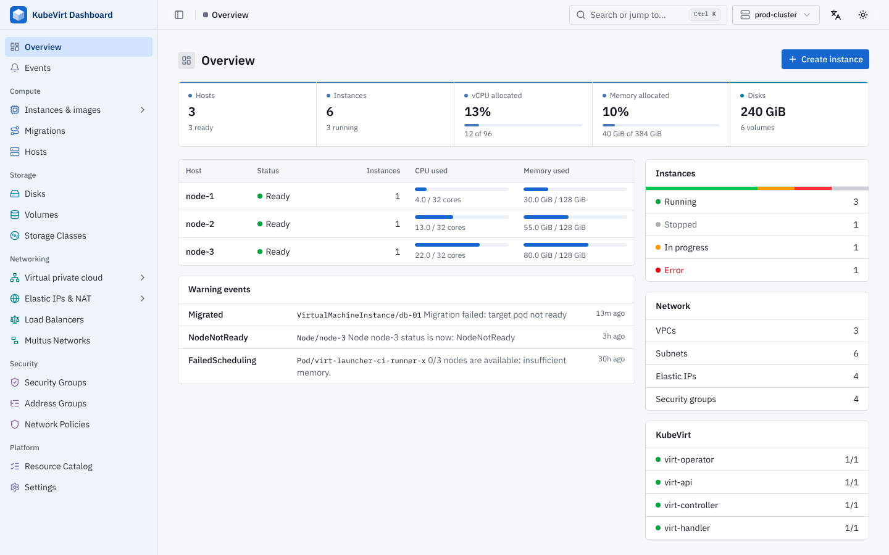
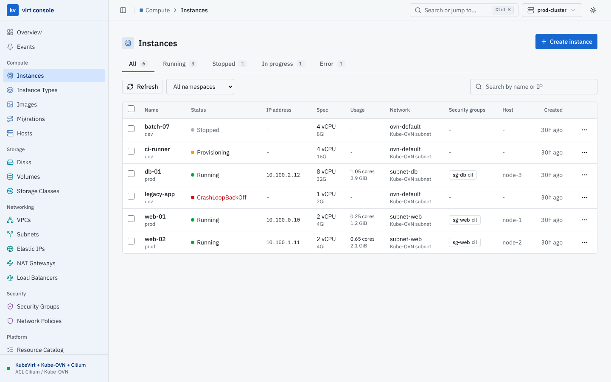
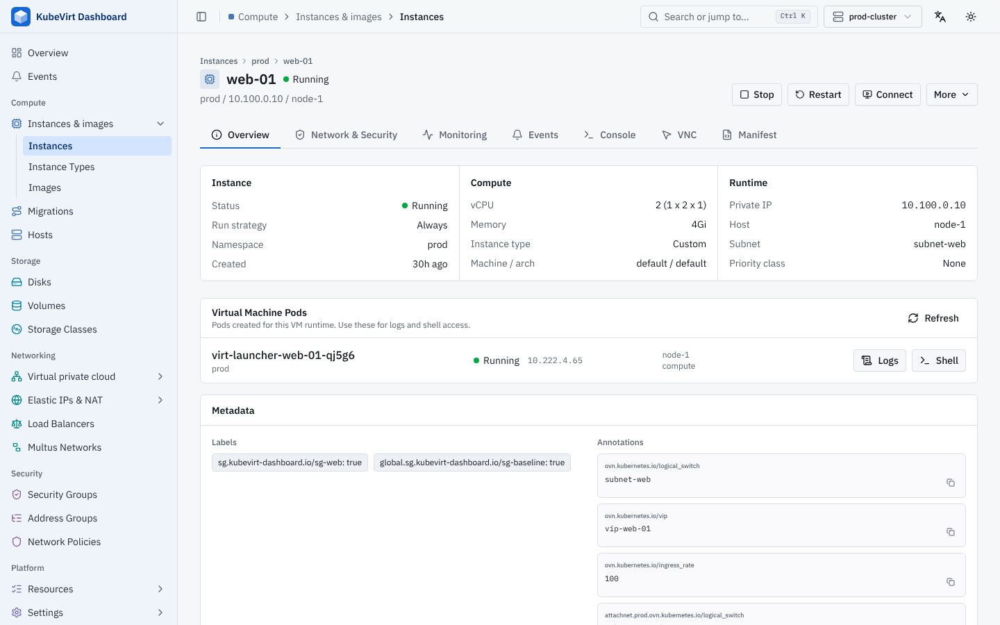
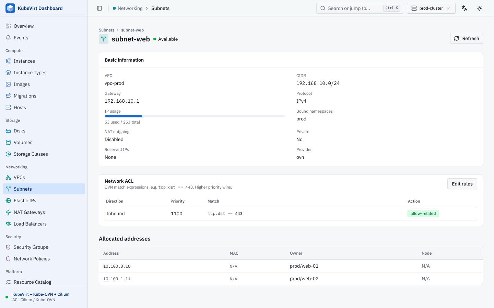
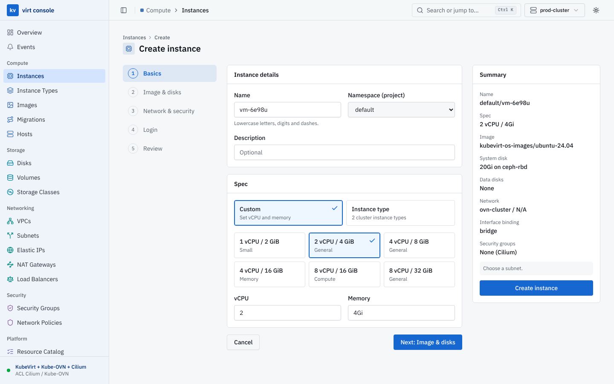

# KubeVirt Dashboard

A single-binary web console for KubeVirt clusters, organized like a public cloud console: instances, disks, VPCs, subnets and security groups on top of KubeVirt, CDI, Kube-OVN and Cilium.



## Features

- **Cloud console layout**: Compute (instances, instance types, images, pools, snapshots, migrations, hosts), Storage (disks, volumes, storage classes, volume snapshots), Networking (VPCs, subnets, elastic IPs, NAT gateways, load balancers, Multus networks) and Security (security groups, network policies). Every other API resource is reachable from the **Resource Catalog**.
- **Instance wizard**: create a VM step by step (spec or instance type, image and disks, VPC/subnet and security groups, cloud-init login) and review the exact manifest before submitting.
- **Network stacks**: detects Kube-OVN and Cilium and adapts instance networking and security groups (see below).
- **Filtering**: every list filter is a text box with suggestions (namespaces, VPCs, kinds), and the search box filters any shown column with `field:value` tokens, e.g. `web status:running host:node-1 -ns:dev`. An exact namespace is sent to the API; partial text filters locally. Long lists are paged.
- **NAT**: elastic IPs, SNAT, DNAT and floating IPs for both Kube-OVN NAT models: VPC NAT gateways (`IptablesEIP`, `Iptables*Rule`) and OVN native NAT (`OvnEip`, `OvnSnatRule`, `OvnDnatRule`, `OvnFip`).
- **Events and monitoring**: a cluster-wide event browser, events on every resource detail page, live CPU and memory from metrics-server, and VM history charts from Prometheus when one is configured.
- **Discovery aware**: the UI checks which API groups and versions the selected cluster serves and hides resources it does not serve.
- **Multi-cluster**: switch between kubeconfig contexts from the header.
- **Consoles and pod access**: serial console and VNC for VMs; logs and an interactive shell for related pods.
- **Single binary**: the UI is embedded in the Go binary.

## Screenshots

| Instances | Instance detail |
|-----------|-----------------|
|  |  |
| **Subnet detail** | **Create instance** |
|  |  |

## Network Stacks

The stack is detected from the CRDs the cluster serves and can be overridden per cluster in **Settings**.

| Stack | Instance networking | Security groups |
|-------|---------------------|-----------------|
| KubeVirt | Pod network | Not available; use Kubernetes NetworkPolicy |
| KubeVirt + Kube-OVN | Kube-OVN VPC and subnet (`ovn.kubernetes.io/logical_switch`) | Kube-OVN `SecurityGroup` (`ovn.kubernetes.io/security_groups`) |
| KubeVirt + Kube-OVN + Cilium (recommended) | Kube-OVN VPC and subnet | `CiliumNetworkPolicy` by default; Kube-OVN `SecurityGroup` can be chosen per group and per instance |
| KubeVirt + Cilium | Pod network | `CiliumNetworkPolicy` |

Cilium security groups are `CiliumNetworkPolicy` objects in the instance namespace that select the label `sg.kubevirt-dashboard.io/<name>=true`; the console sets that label on the VM template. Kube-OVN security groups are cluster scoped and attached through the `ovn.kubernetes.io/security_groups` annotation with port security enabled. Subnets in Kube-OVN mode also have a subnet-level network ACL editor.

Attaching or detaching a security group updates the VM template and the running virt-launcher pod. If the CNI does not apply pod changes live, the change takes effect on the next restart.

## Monitoring

- **metrics-server** (`metrics.k8s.io`): when installed, host CPU and memory usage appear on the overview and live usage on instance pages.
- **Prometheus**: configure the Prometheus service in **Settings → Monitoring** (namespace, service and port). Queries go through the Kubernetes API service proxy, so Prometheus does not need to be exposed outside the cluster. VM charts use the metrics KubeVirt exports (`kubevirt_vmi_*`).

## API Versions

The console talks to the cluster through the Kubernetes API and uses these API versions, falling back to older ones when the cluster does not serve the preferred version. The CRD lists were checked against KubeVirt 1.9.1, Cilium 1.20.3 and Kube-OVN 1.16.15.

| Component | API versions used |
|-----------|-------------------|
| KubeVirt | `kubevirt.io/v1`, `instancetype.kubevirt.io/v1beta1`, `snapshot.kubevirt.io/v1beta1`, `pool.kubevirt.io/v1beta1` (KubeVirt 1.7+, falls back to `v1alpha1`) |
| CDI | `cdi.kubevirt.io/v1beta1` |
| Kube-OVN | `kubeovn.io/v1` |
| Cilium | `cilium.io/v2`; `v2alpha1` for kinds that have not graduated, and as a fallback for BGP and LB IP pool resources on older releases |
| Metrics | `metrics.k8s.io/v1beta1` (metrics-server), Prometheus HTTP API |

## Security

The dashboard has **no authentication of its own**. Every request runs with the credentials of the kubeconfig context (local mode) or of the `kubevirt-dashboard` service account (in-cluster mode), and the bundled ClusterRole allows creating, updating and deleting any resource. Anyone who can reach the dashboard can therefore administer the cluster.

- Prefer `kubectl port-forward` or binding to `127.0.0.1`.
- Do not apply `manifest/nodeport.yaml` or `manifest/ingress.yaml` without putting an authenticating proxy (for example oauth2-proxy) in front, and restricting who can reach it.
- Narrow the ClusterRole in `manifest/deploy.yaml` if you only need part of the console.

## Installation

### Binary

Download a release from the [Releases](https://github.com/jimyag/kubevirt-dashboard/releases) page and run it against your current kubeconfig:

```bash
./kubevirt-dashboard --listen 127.0.0.1:11111
```

| Flag | Default | Description |
|------|---------|-------------|
| `--listen` | `127.0.0.1:11111` | Address to serve the console on |
| `--kubeconfig` | `$KUBECONFIG` or `~/.kube/config` | Kubeconfig file |
| `--context` | current context | Context selected when the browser has none stored |

### In cluster

```bash
kubectl apply -f manifest/deploy.yaml
kubectl port-forward -n kubevirt-dashboard svc/kubevirt-dashboard 8080:80
```

Then open http://127.0.0.1:8080. Read [Security](#security) before exposing it any other way.

## Development

Prerequisites:

- Go 1.27+
- Bun (frontend package manager and build)

```bash
cd ui && bun install && cd ..
make                      # builds ui/dist, then the Go binary with the UI embedded
./kubevirt-dashboard --listen 127.0.0.1:11111
```

For UI work, run the Go binary on port 11111 and start the Vite dev server, which proxies `/api` and `/apis` to it:

```bash
cd ui && bun run dev
```

UI conventions (theme tokens, shared components, copy style) are in [AGENTS.md](AGENTS.md).

### Dependency notes

`kubevirt.io/client-go` 1.9 imports client-go packages that Kubernetes removed in 0.35, so `k8s.io/*` stays on 0.34.x until a KubeVirt SDK release supports newer clients. The `github.com/openshift/*` and `k8s.io/kube-openapi` replacements in `go.mod` follow the SDK's own `go.mod`; update them together with the SDK.

## License

MIT
