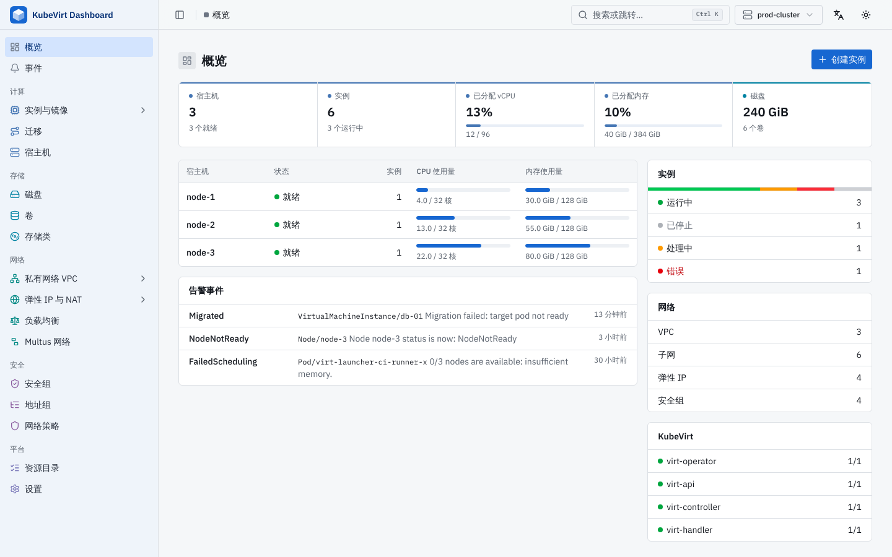
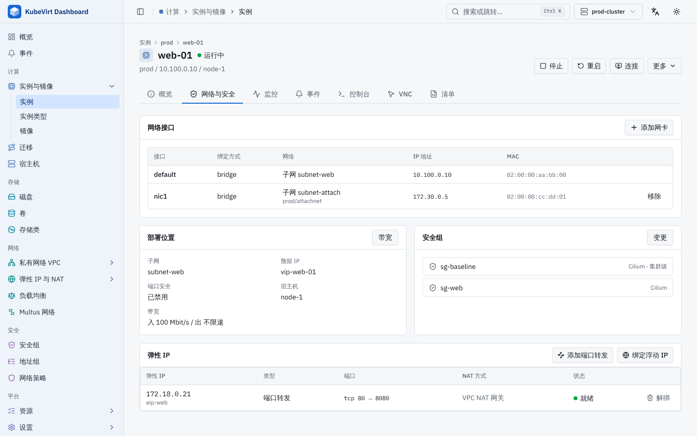

# KubeVirt Dashboard

A single-binary web console for KubeVirt clusters, organized like a public cloud console: instances, disks, VPCs, subnets and security groups on top of KubeVirt, CDI, Kube-OVN and Cilium.


## Features

- **Cloud console layout**: sections with second-level groups, like a public cloud console. Compute (instances and images, snapshots and migrations, hosts), Storage (disks, volumes, storage classes, volume snapshots), Networking (VPC: VPCs, subnets, route tables, peering connections, reserved IPs, IP pools; Elastic IPs & NAT: elastic IPs, NAT gateways, SNAT rules, DNAT rules, floating IPs; load balancers; Multus networks) and Security (security groups, address groups, network policies). Every other API resource is reachable from the **Resource Catalog**.
- **Instance wizard**: create a VM step by step (spec or instance type, image and disks, VPC/subnet and security groups, cloud-init login) and review the exact manifest before submitting.
- **Network stacks**: detects Kube-OVN and Cilium and adapts instance networking and security groups (see below).
- **Filtering**: every list filter is a text box with suggestions (namespaces, VPCs, kinds), and the search box filters any shown column with `field:value` tokens, e.g. `web status:running host:node-1 -ns:dev`. An exact namespace is sent to the API; partial text filters locally. Long lists are paged.
- **NAT**: elastic IPs, SNAT, DNAT and floating IPs for both Kube-OVN NAT models: VPC NAT gateways (`IptablesEIP`, `Iptables*Rule`) and OVN native NAT (`OvnEip`, `OvnSnatRule`, `OvnDnatRule`, `OvnFip`). Each NAT gateway has a detail page listing its elastic IPs and the SNAT, DNAT and floating IP rules on them. An instance's network tab shows its elastic IPs and binds a floating IP or adds port forwarding directly.
- **VPC networking** (Kube-OVN): static and policy routes, VPC peering, reserved private IPs (`Vip`), IP pools per subnet, per-instance bandwidth limits, and extra NICs on Kube-OVN subnets or other networks through Multus.
- **Cilium security groups**: per namespace (`CiliumNetworkPolicy`) or cluster wide (`CiliumClusterwideNetworkPolicy`), with address groups (`CiliumCIDRGroup`) as rule sources and destinations.
- **Helm**: Helm releases under **Resource Catalog → Helm Releases**: list, the objects each release created with their live status and links to their pages, values, chart defaults, rendered manifest, notes and history; edit values with a diff review, change the chart version, roll back, install from any HTTP or OCI chart repository, and uninstall. Uses the Helm SDK in the dashboard binary, storing releases the same way as the `helm` CLI.
- **Manifests**: `kubectl get -o yaml` output with highlighting, search and folding; edits are saved after a diff review and rejected if someone else changed the object meanwhile.
- **Events and monitoring**: a cluster-wide event browser, events on every resource detail page, live CPU and memory from metrics-server, and VM history charts from any Prometheus-compatible backend (Prometheus, VictoriaMetrics, Thanos) when one is configured.
- **Languages**: English and Simplified Chinese, switched from the header or Settings; the browser language is used by default.
- **Discovery aware**: the UI checks which API groups and versions the selected cluster serves and hides resources it does not serve.
- **Multi-cluster**: switch between kubeconfig contexts from the header.
- **Consoles and pod access**: serial console and VNC for VMs; logs and an interactive shell for related pods.
- **Single binary**: the UI is embedded in the Go binary.

## Screenshots

| Instances | Instance detail |
|-----------|-----------------|
|  |  |
| **Subnet detail** | **Create instance** |
|  |  |
| **Overview (Chinese)** | **Instance network and elastic IPs (Chinese)** |
|  |  |

## Network Stacks

The stack is detected from the CRDs the cluster serves; the console shows the resulting capabilities (VPCs, security groups, elastic IPs) rather than component names. Detection can be overridden per cluster under **Settings → Networking → Advanced**.

| Stack | Instance networking | Security groups |
|-------|---------------------|-----------------|
| KubeVirt | Pod network | Not available; use Kubernetes NetworkPolicy |
| KubeVirt + Kube-OVN | Kube-OVN VPC and subnet (`ovn.kubernetes.io/logical_switch`) | Kube-OVN `SecurityGroup` (`ovn.kubernetes.io/security_groups`) |
| KubeVirt + Kube-OVN + Cilium | Kube-OVN VPC and subnet | `CiliumNetworkPolicy` by default; Kube-OVN `SecurityGroup` can be chosen per group and per instance |
| KubeVirt + Cilium | Pod network | `CiliumNetworkPolicy` |

Cilium security groups are `CiliumNetworkPolicy` objects in the instance namespace that select the label `sg.kubevirt-dashboard.io/<name>=true`; the console sets that label on the VM template. Cluster-wide groups are `CiliumClusterwideNetworkPolicy` objects selecting `global.sg.kubevirt-dashboard.io/<name>=true`, so instances in any namespace can join them. Kube-OVN security groups are cluster scoped and attached through the `ovn.kubernetes.io/security_groups` annotation with port security enabled. Subnets in Kube-OVN mode also have a subnet-level network ACL editor.

Attaching or detaching a security group updates the VM template and the running virt-launcher pod. If the CNI does not apply pod changes live, the change takes effect on the next restart.

The instance wizard offers persistent image imports, cloning and new data disks when CDI is served; otherwise it defaults to an ephemeral container disk. Primary subnet choices exclude Multus-only providers, which remain available as extra interfaces.

Reserved IPs use namespace-free Kube-OVN `Vip` objects, with the wizard's namespace scope stored in `kubevirt-dashboard.io/reserved-ip-namespace`. Setting `Vip.spec.namespace` invokes Kube-OVN's AAP virtual-port handling and can blackhole a VM that consumes the same address. Older namespaced reservations are marked **Needs recreation** and cannot be selected for a new VM; release an unused reservation and create it again through the console. An address referenced by an instance or reserved by the controller cannot be released until that use ends. The namespace annotation controls wizard choices; it is not a Kubernetes authorization policy.

## Monitoring

- **metrics-server** (`metrics.k8s.io`): when installed, host CPU and memory usage appear on the overview and live usage on instance pages.
- **Deploy**: **Settings → Monitoring** deploys a backend with Helm. Choose Prometheus or VictoriaMetrics, and an operator stack (kube-prometheus-stack, victoria-metrics-k8s-stack) or a single server (prometheus, victoria-metrics-single). The recommended values already scrape KubeVirt's `kubevirt-prometheus-metrics` service and can be edited on the page before deploying; afterwards the release can be edited, upgraded or removed from the same page or from Helm Releases, and **Use for metrics** points the console at it.
- **History** (Prometheus API): in **Settings → Monitoring**, **Detect in cluster** finds the query services that kube-prometheus-stack, the prometheus chart, the VictoriaMetrics operator (`VMSingle`, `VMCluster` vmselect) and the victoria-metrics-single chart create, or enter namespace, service, port and an optional path prefix (`/select/0/prometheus` for a VictoriaMetrics cluster). Queries go through the Kubernetes API service proxy, so the backend does not need to be exposed outside the cluster. VM charts use the metrics KubeVirt exports (`kubevirt_vmi_*`) and match the VMI namespace whether the scrape kept it as `namespace` or renamed it to `exported_namespace`.
- Verified on a k3s cluster with kube-prometheus-stack (Prometheus 3.7), the VictoriaMetrics operator with a `VMSingle`, and the victoria-metrics-single chart (VictoriaMetrics 1.128), each installed from its chart.

Key/value editors accept one `key=value` per line. Values containing newlines, surrounding whitespace, or leading quotes use JSON string syntax, for example `config="line one\nline two"`; the editor preserves these values when saving. RBAC rule and subject editors use JSON arrays to preserve all Kubernetes fields and restrictions.

VM pool **Detach VM** accepts only a VM owned by that pool. It removes pool ownership, selector labels and the pool finalizer while preserving other owners and finalizers. The target node is saved in the VM template; a running VM uses it after restarting.

FlowSchema subjects use `User|name`, `Group|name`, or `ServiceAccount|name|namespace`, one per line. A service account without a namespace uses `default`. Clearing **API groups** selects the core API group; **Namespaces** and **Cluster scope** select the rule's resource scope. Priority levels use the stable API's nominal concurrency shares.

Certificate requests accept PEM or Base64; PEM is encoded for the Kubernetes API. CRD names are generated from `plural.group`. PriorityClass, RuntimeClass, Endpoints and EndpointSlice editors patch top-level fields; other control-plane editors patch `spec`. Quote numeric or boolean strings explicitly, for example `internalPort="81"`; unquoted `replicas=0`, `enabled=false`, arrays and objects retain their JSON types. Kubernetes rejects immutable field changes. ValidatingAdmissionPolicy creation accepts match constraints as JSON, including resource rules and namespace selectors; bindings initially use `Warn`.

CDI DataSources reference a PVC, VolumeSnapshot or another DataSource. VolumeCloneSource references a PVC in the same namespace. DataImportCron uses a Registry URL and requires a managed DataSource name; choose an explicit access mode when the StorageProfile has no defaults. CDI rejects changes to an existing DataImportCron spec, so recreate it to change the schedule. Manual VM snapshot-content creation requires the saved VM's `metadata` and `spec`; a VM name alone is insufficient. Schema forms expose SwitchLBRule ports and VpcEgressGateway policies as individual array items. VLAN ID `0` creates an untagged provider network. DNSNameResolver takes one fully qualified DNS name ending in a dot.

Kube-OVN native OVN SNAT, DNAT and FIP mappings must be recreated to change their endpoints, ports or mode. Their controllers do not apply those changes to an existing mapping, so the console omits the generic spec-edit action for these resources. Metadata editing and manifest inspection remain available.

QoSPolicy forms expose individual bandwidth rules and a binding type of `EIP` or `NATGW`. NAT gateway policies must be shared. The policy takes effect after an EIP or NAT gateway references its name through `spec.qosPolicy`. Non-shared policies allow editing bandwidth rules; shared policies and binding types must be recreated to change them.

## API Versions

Custom resources are discovered from the cluster under Resource Catalog → Custom resources. Each CRD exposes every served API version, including alpha and beta versions; the initial selection follows the API group's preferred version. Envoy Gateway resources have a separate catalog entry and use the same discovery and editing components.

Catalog resource lists use the API server's Kubernetes Table response to display the CRD's printer columns. Those columns participate in filtering without modifying the resource objects used by the editor.

Create and edit forms read the selected CRD's structural OpenAPI schema. Named resource pages follow served group/version/plural fallbacks as well, including Calico's native v3 APIs. Objects use flat sections, arrays use expandable rows, and primitive fields use typed controls. Labels and annotations share the same form as resource fields, with individual key/value rows for adding, renaming and deleting entries. System annotations can be expanded separately. Status and server-managed identity fields are not editable in this form. Existing fields with an explicit CEL `self == oldSelf` rule are shown read-only; ancestors cannot be removed to bypass that guard. New resources and new keyed list entries remain editable.

Saving validates the schema locally and runs an API server dry-run before showing a diff. Updates retain the original resourceVersion and untouched fields, so concurrent changes are rejected. CRD schemas do not always describe a controller's restrictions; admission success alone does not prove reconciliation or traffic behavior. The Manifest tab remains available for advanced edits.

The console talks to the cluster through the Kubernetes API and uses these API versions, falling back to older ones when the cluster does not serve the preferred version. The CRD lists were checked against KubeVirt 1.9.1, Cilium 1.20.4, Calico 3.33.0, Envoy Gateway 1.9.2 and Kube-OVN 1.16.15.

| Component | API versions used |
|-----------|-------------------|
| KubeVirt | `kubevirt.io/v1`, `instancetype.kubevirt.io/v1beta1`, `snapshot.kubevirt.io/v1beta1`, `pool.kubevirt.io/v1beta1` (KubeVirt 1.7+, falls back to `v1alpha1`) |
| CDI | `cdi.kubevirt.io/v1beta1` |
| Kube-OVN | `kubeovn.io/v1` |
| Cilium | `cilium.io/v2`; `v2alpha1` for kinds that have not graduated, and as a fallback for BGP and LB IP pool resources on older releases |
| Metrics | `metrics.k8s.io/v1beta1` (metrics-server), Prometheus HTTP query API (Prometheus, VictoriaMetrics, Thanos) |

## Security

The dashboard has **no authentication of its own**. Every request runs with the credentials of the kubeconfig context (local mode) or of the `kubevirt-dashboard` service account (in-cluster mode), and the bundled ClusterRole allows creating, updating and deleting any resource. Anyone who can reach the dashboard can therefore administer the cluster.

- Prefer `kubectl port-forward` or binding to `127.0.0.1`.
- Do not apply `manifest/nodeport.yaml` or `manifest/ingress.yaml` without putting an authenticating proxy (for example oauth2-proxy) in front, and restricting who can reach it.
- Console, VNC and pod shell WebSockets only accept pages served by the dashboard itself (same origin), so other sites open in the same browser cannot use them. Behind a proxy that rewrites the Host header, list the public origin with `--allowed-origin`.
- The Helm pages install, upgrade and uninstall charts from any repository with the same credentials, so a chart can create any resource the dashboard can. Releases are stored as Secrets in their namespace, like the `helm` CLI; chart sources the dashboard used are kept in the `kubevirt-dashboard-helm-sources` ConfigMap of each namespace.
- Narrow the ClusterRole in `manifest/deploy.yaml` if you only need part of the console.

## Installation

### Binary

Download a release from the [Releases](https://github.com/jimyag/kubevirt-dashboard/releases) page and run it against your current kubeconfig:

```bash
./kubevirt-dashboard --listen 127.0.0.1:11111
```

| Flag | Default | Description |
|------|---------|-------------|
| `--listen` | `127.0.0.1:11111` | Address to serve the console on |
| `--kubeconfig` | `$KUBECONFIG` or `~/.kube/config` | Kubeconfig file |
| `--context` | current context | Context selected when the browser has none stored |
| `--allowed-origin` | none | Extra browser origin (e.g. `https://dash.example.com`) allowed to open console, VNC and pod shell WebSockets when a reverse proxy rewrites the Host header; repeatable |

### In cluster

Install the Helm chart from this repository:

```bash
helm upgrade --install kubevirt-dashboard ./charts/kubevirt-dashboard \
  --namespace kubevirt-dashboard --create-namespace
kubectl port-forward -n kubevirt-dashboard svc/kubevirt-dashboard 8080:80
```

Use `--set image.tag=<tag>` to select a built image. The chart grants cluster-wide
administration permissions, matching the deployment manifest; keep access local
or protect it with an authenticating proxy as described in [Security](#security).

Alternatively, use the deployment manifest:

```bash
kubectl apply -f manifest/deploy.yaml
kubectl port-forward -n kubevirt-dashboard svc/kubevirt-dashboard 8080:80
```

Then open http://127.0.0.1:8080. Read [Security](#security) before exposing it any other way.

## Development

Prerequisites:

- Go 1.27+
- Bun (frontend package manager and build)

```bash
cd ui && bun install && cd ..
make                      # builds ui/dist, then the Go binary with the UI embedded
./kubevirt-dashboard --listen 127.0.0.1:11111
```

For UI work, run the Go binary on port 11111 and start the Vite dev server, which proxies `/api` and `/apis` to it:

```bash
cd ui && bun run dev
```

UI conventions (theme tokens, shared components, copy style) are in [AGENTS.md](AGENTS.md).

### Dependency notes

`kubevirt.io/client-go` 1.9 imports client-go packages that Kubernetes removed in 0.35, so `k8s.io/*` stays on 0.34.x until a KubeVirt SDK release supports newer clients. The `github.com/openshift/*` and `k8s.io/kube-openapi` replacements in `go.mod` follow the SDK's own `go.mod`; update them together with the SDK.

## License

MIT
